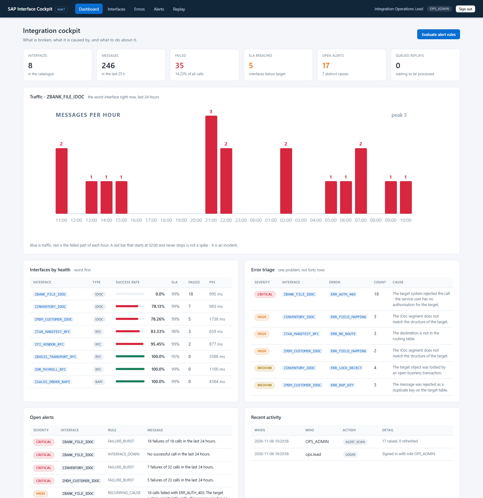
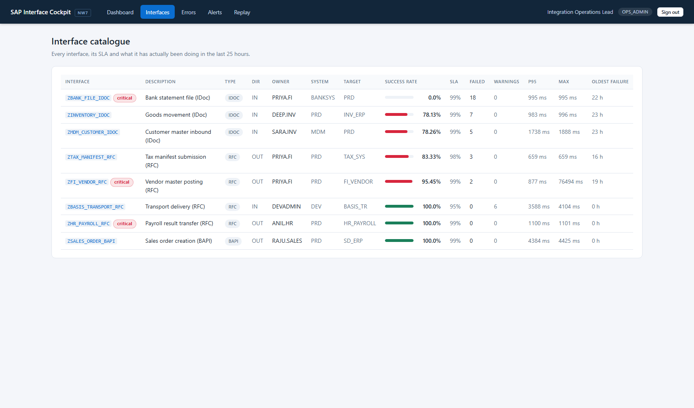
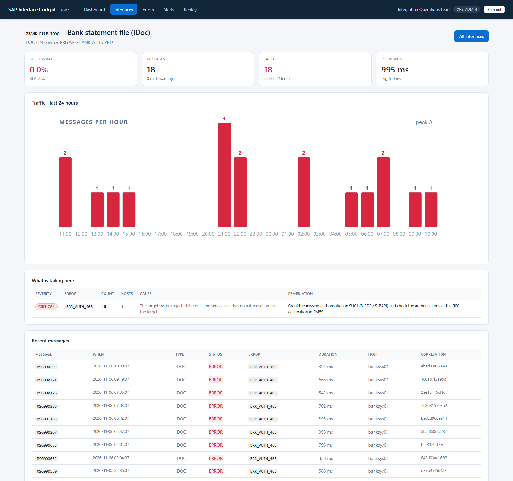
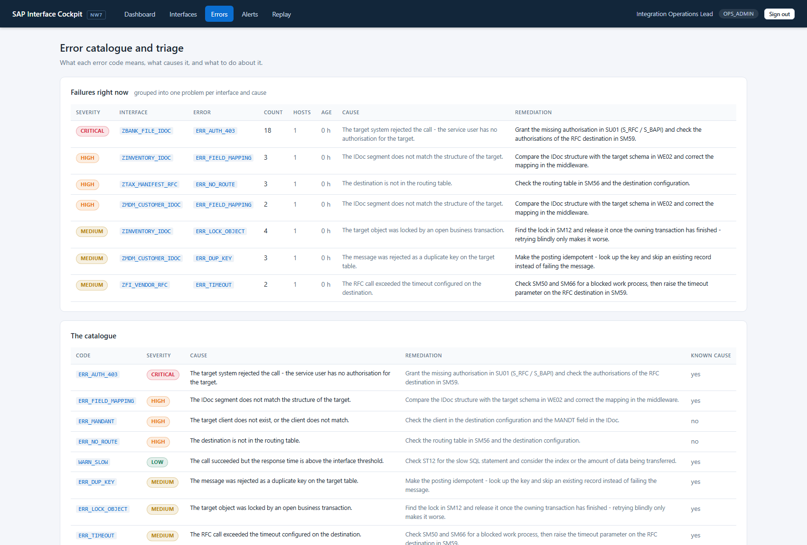
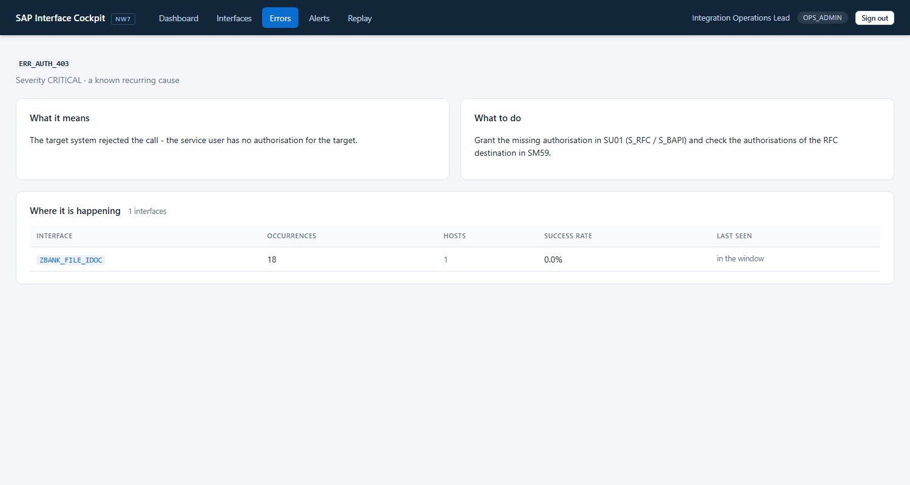
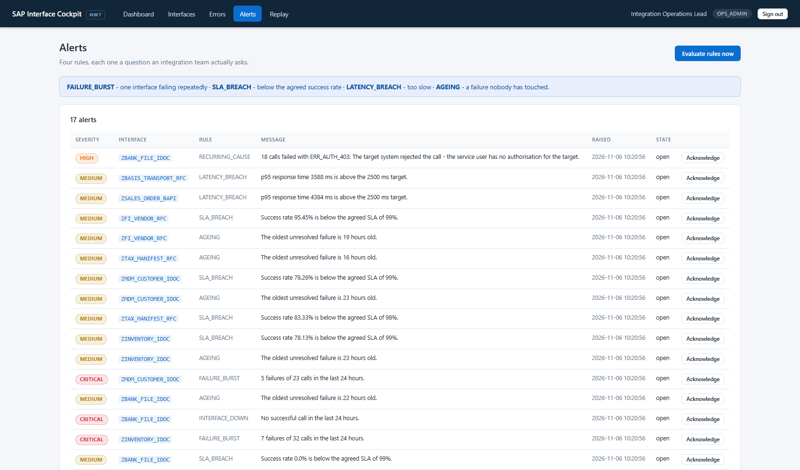
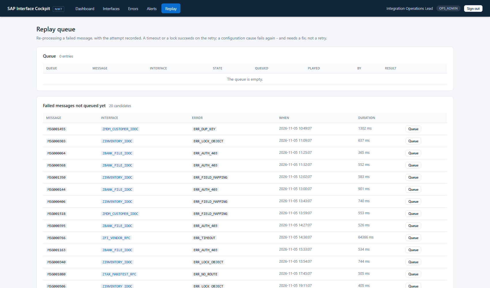
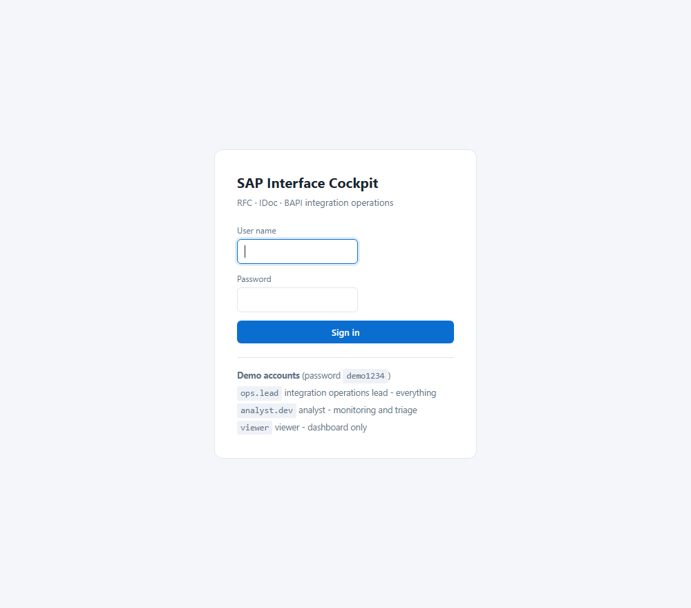

<div align="center">

# SAP Interface Cockpit

**Integration operations for SAP landscapes — RFC · IDoc · BAPI monitoring, error triage, alerting and replay**


</div>

---

## The problem

Interfaces fail at 03:00 and nobody notices until the business complains in the
morning. By then the log holds three hundred rows, and the first hour of
support is spent finding out whether it is three hundred problems or one.

This cockpit turns that wall of red rows into **one sentence per problem**:
which interface, which cause, how long, and what to do about it.

| Module | Answers |
|---|---|
| **Interface health** | Which interfaces are below their SLA, which are too slow, and how long has the oldest failure been waiting? |
| **Error triage** | Group the failures into *one problem per interface and cause*, enriched with the cause and the remediation from an error catalogue |
| **Alerting** | Four rules — failure burst, SLA breach, latency breach, ageing — deduplicated so a re-scan refreshes rather than floods |
| **Replay queue** | Re-process a failed message with the attempt, the operator and the outcome recorded |
| **Audit trail** | Who acknowledged which alert, and who replayed which message |

The seeded landscape contains one interface that **started failing at 02:00
yesterday with the same authorisation error on every call** — which is the
shape of a real incident, and exactly what the triage screen exists to turn
into an actionable line.

---

## Screenshots

### The cockpit — what is broken, what it is caused by



### Interface health — SLA, latency and the oldest failure



### One interface, hour by hour

> Every bar is red, and it never stops. A spike is a bar; an incident is a
> shape. The chart is what makes the difference visible.



### Error triage — one problem, not forty rows



### The error catalogue — cause and remediation



### Alerts



### Replay queue



### Sign in



---

## Run it

### Requirements

* **Java 8 or newer** (the code targets Java 8 and `javax.servlet`, so it can
  be deployed on the NetWeaver 7.5 Java stack)
* **Maven 3.6+**
* Nothing else. No SAP system, no SAP licence, no database server.

```bash
git clone https://github.com/Revanth2716/sap-interface-cockpit.git
cd sap-interface-cockpit
mvn clean package
java -jar target/sap-interface-cockpit.jar
```

Open <http://localhost:8082> and sign in:

| User | Role | Sees |
|---|---|---|
| `ops.lead` | OPS_ADMIN | Everything, including alerts and the replay queue |
| `analyst.dev` | ANALYST | Monitoring, triage and alerts |
| `viewer` | VIEWER | Dashboard only |

Password: `demo1234` (configurable; the accounts can be switched off with
`cockpit.seed-demo-users=false`).

### Run the tests

```bash
mvn test
```

```
Tests run: 50, Failures: 0, Errors: 0, Skipped: 0
BUILD SUCCESS
```

### What the demo landscape contains

| | |
|---|---|
| 8 interfaces | RFC, IDoc and BAPI, inbound and outbound, across FI, HR, Inventory, Sales and Basis |
| 7 days of traffic | ~1,540 generated messages, dated relative to *now* |
| 1 live incident | `ZBANK_FILE_IDOC` has failed **every** call since 02:00 yesterday with `ERR_AUTH_403` |
| 1 slow interface | `ZSALES_ORDER_BAPI` succeeds every time, but breaks the latency target |
| 8 error codes | each with a cause, a remediation and a severity |
| 7 error clusters | the failures of the last 24 hours, grouped into problems |

---

## Architecture

```
                    ┌────────────────────────────────────────┐
                    │        web layer (Spring MVC)          │
                    │  Dashboard · Interfaces · Errors ·      │
                    │  Alerts · Replay · REST API             │
                    └───────────────────┬────────────────────┘
                                        │
                    ┌───────────────────▼────────────────────┐
                    │            service layer               │
                    │  InterfaceHealthService (SLA, p95)      │
                    │  ErrorTriageService   (grouping)        │
                    │  AlertService         (rules)           │
                    │  ReplayService        (queue)           │
                    │  DashboardService · AuditService        │
                    └───────────────────┬────────────────────┘
                                        │
                    ┌───────────────────▼────────────────────┐
                    │       repository layer (JdbcTemplate)   │
                    │  IFDEF · IFLOG · IFERR · IFALERT         │
                    │  IFQUEUE                                │
                    └───────────────────┬────────────────────┘
                                        │
              ┌─────────────────────────┴─────────────────────────┐
              │                                                   │
   ┌──────────▼───────────┐                        ┌──────────────▼─────────────┐
   │  SqliteDataSource    │                        │  HanaJdbcDataSource        │
   │  local seeded data   │                        │  live NetWeaver / HANA      │
   └──────────────────────┘                        └────────────────────────────┘
```

Four decisions carry the project:

**1. Triage groups failures into problems, not rows.**
Forty failures of the same error code on the same interface are **one**
incident. The triage service groups the window by interface and error code,
counts the occurrences, works out how many hosts it came from, and enriches
the group with the cause and the remediation from the error catalogue. That
one sentence is what a support engineer can act on.

**2. The error catalogue is what turns a log into a runbook.**
Every error code carries its cause and the action that resolves it — *"the
service user has no authorisation on the target: grant `S_RFC` in `SU01` and
check the destination in `SM59`"*. Without that mapping the cockpit would
only tell you *that* something broke.

**3. The alerting rules are questions, not thresholds.**
`FAILURE_BURST`, `SLA_BREACH`, `LATENCY_BREACH`, `AGEING` — four things an
integration team actually asks. Alerts are keyed on interface + rule, so
re-running the evaluation refreshes an alert rather than raising a second
one, and acknowledging one is recorded.

**4. The replay is simulated honestly.**
The project cannot call a customer system, so the replay is simulated — but
honestly: an error caused by a transient condition (a timeout, a lock)
*succeeds* on the retry, because that is what actually happens; an error
caused by configuration *fails again*, because that is what actually
happens too. That is what makes the queue a triage instrument rather than a
to-do list.

---

## The SAP-side artifacts

The ABAP and the RFC client that a live NetWeaver system would talk to are
included. They are written against NetWeaver 7.5 semantics and are **ready
to compile**; they have not been executed on a live system, because none was
available when this was built (see `docs/HONEST-STATUS.md`).

| File | Purpose |
|---|---|
| `abap/Z_IF_LOG_READ.abap` | RFC-enabled function module that reads the interface message log from `TRFC` and `EDIDC` |
| `abap/ZIF_LOG_TYPES.abap` | The DDIC structure (`ZIF_LOG_MSG`) the module imports |
| `src/extra/java/.../RfcInterfaceLogGateway.java` | JCo client that calls it over an RFC destination maintained in `SM59` |

> **The one line that decides whether RFC works at all:** create the function
> module in `SE37` with **Remote-Enabled** ticked. Without it the call fails
> with *"function module not found / not remote enabled"* — and the error
> surfaces as an `SM58` entry on the **calling** system, not as a dump on
> the callee. That asymmetry is what makes it confusing the first time.

---

## Moving to a live SAP system

```bash
mvn -Pwith-jco clean package     # adds the JCo RFC adapter
mvn -Phana   clean package       # adds the SAP HANA JDBC driver
```

The SQL is portable ANSI, so pointing the datasource at HANA is a
configuration change, not a code change. Full detail in
[`docs/DEPLOYMENT.md`](docs/DEPLOYMENT.md).

---

## Testing

50 tests across five classes:

| Test class | What it locks in |
|---|---|
| `InterfaceHealthServiceTest` | The SLA arithmetic, the percentile, the hourly bucketing and the "worst first" ordering |
| `ErrorTriageServiceTest` | Failures group into one cluster per interface and cause; a cluster carries the catalogue cause and remediation; the clusters are ordered by severity |
| `AlertAndReplayServiceTest` | The burst and latency rules fire; a second evaluation does **not** duplicate an alert; a transient error succeeds on replay and a configuration error fails again |
| `ApiControllerTest` | The REST API and the per-interface report |
| `PageRenderTest` | **Every screen renders** — a template can compile and the service layer can be green while one page still returns HTTP 500 |

That last one earned its place during this build: the `/replay` screen was
returning HTTP 500 because the template file had never been written, and no
service-level test could have found it.

---

## Resume content

Copy-paste blocks are in [`docs/RESUME.md`](docs/RESUME.md). The short form:

> **SAP Interface Cockpit** — integration operations for SAP landscapes
> *Java 8 · Spring Boot 2.7 · JdbcTemplate · SAP HANA · Thymeleaf · ABAP RFC · SAP Java Connector*
>
> - Built an **integration operations cockpit for SAP landscapes** that monitors RFC, IDoc and BAPI traffic, tracks each interface against its SLA (success rate, p95 latency, oldest unresolved failure) and raises **four rule-based alerts** — failure burst, SLA breach, latency breach and ageing.
> - Implemented **error triage that groups failures into one problem per interface and cause**, enriched by an error catalogue that maps every code to its cause and its remediation — turning a wall of failed messages into one actionable line.
> - Added a **replay queue** for failed messages that distinguishes transient causes (which succeed on retry) from configuration causes (which fail again and need a fix), with every acknowledgement and replay written to an **audit trail** — plus **RFC-enabled ABAP function modules** and a **SAP Java Connector client** for the live path, backed by **50 automated tests**.

---

## Honest status

| | |
|---|---|
| **Works and is tested today** | the whole application: 50 tests green, the JAR builds, every screen is rendered from the running app |
| **Written but not compiled against SAP** | the ABAP function module, the DDIC types, the JCo adapter — no NetWeaver system and no access to SAP's Maven repository |
| **Modelled, not measured** | the message log is a seeded synthetic dataset with the shape of `TRFC`/`EDIDC`, not a customer's traffic |
| **Known limitation** | the message log covers what the middleware records; a message that never reached the system is invisible to any monitor |

Full detail, and the step that closes each gap, in
[`docs/HONEST-STATUS.md`](docs/HONEST-STATUS.md).

---

## Documentation

| Document | Read it when |
|---|---|
| [`ARCHITECTURE.md`](docs/ARCHITECTURE.md) | You want to know why it is built this way |
| [`DEPLOYMENT.md`](docs/DEPLOYMENT.md) | You are moving it to a real SAP landscape |
| [`TROUBLESHOOTING.md`](docs/TROUBLESHOOTING.md) | A finding looks wrong, or an RFC call fails |
| [`RESUME.md`](docs/RESUME.md) | You are putting this on a CV |
| [`INTERVIEW-QA.md`](docs/INTERVIEW-QA.md) | You are preparing to be asked about it |
| [`HONEST-STATUS.md`](docs/HONEST-STATUS.md) | You need to know exactly what to claim |
| [`LEARNING-LOG.md`](docs/LEARNING-LOG.md) | You want to see the thinking behind the code |

---

## Roadmap

- [ ] Compile and run the ABAP and JCo artifacts against NetWeaver 7.5
- [ ] Read the real message log from `TRFC` / `EDIDC` instead of the seeded model
- [ ] Scheduled evaluation with an e-mail digest of the new alerts
- [ ] Per-interface baselines, so "slower than usual" is measurable, not just "slow"
- [ ] Idempotency check before a replay — never post a duplicate
- [ ] Correlation view: one business document traced across several interfaces

---

## License

MIT — see [LICENSE](LICENSE).

This is a self-initiated portfolio project. SAP, NetWeaver, ABAP, RFC, IDoc
and the table and transaction codes referenced here are trademarks of SAP SE
and are used for technical reference and educational purposes.
